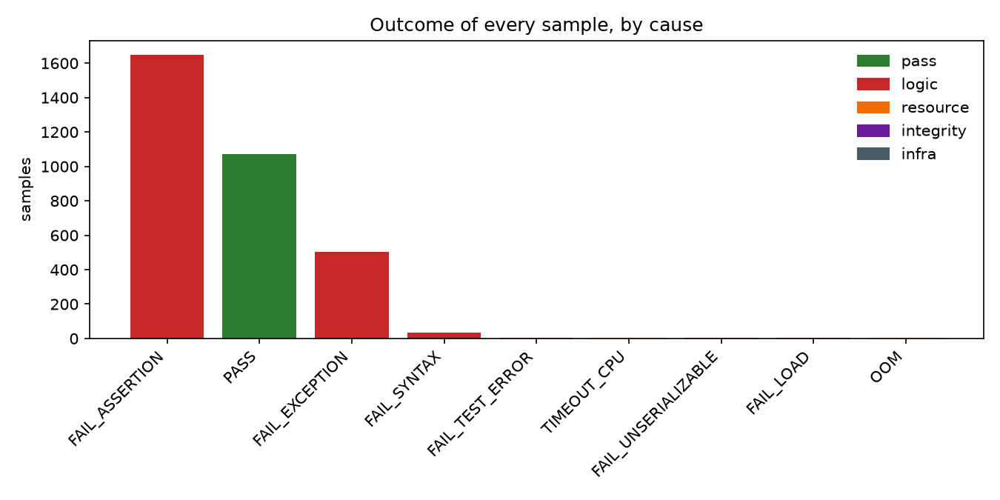
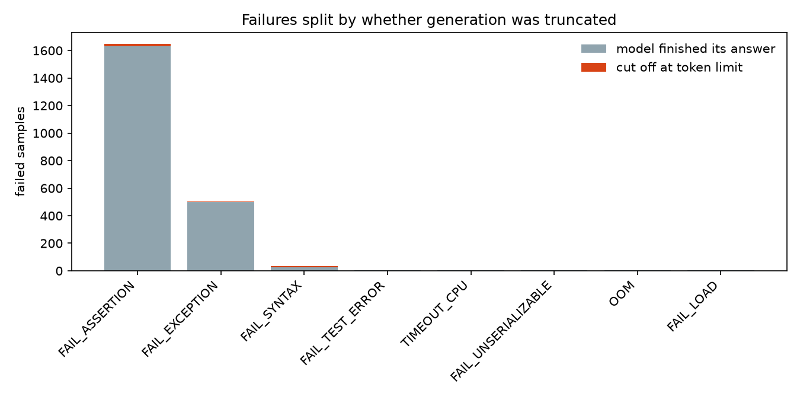
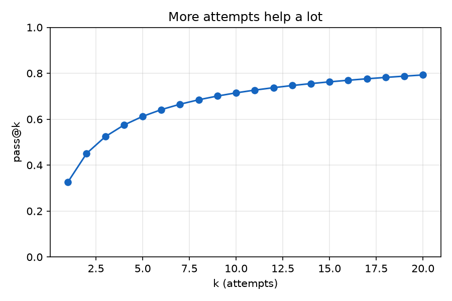
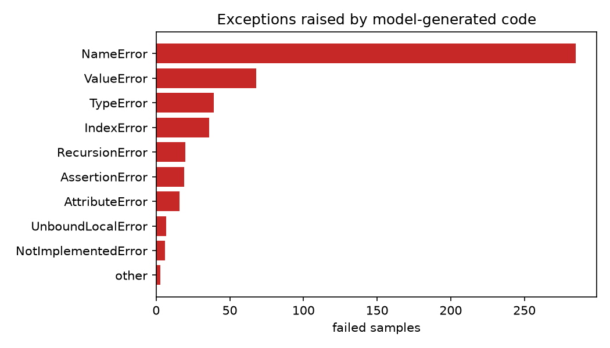

# evalsandbox

A sandbox for running untrusted, model-generated code in HumanEval/MBPP-style benchmarks, built around one question: **when a benchmark says a sample failed, was the model actually wrong?**

## What makes it different

Most harnesses concatenate `program + tests`, run it, and treat exit code 0 as a pass. That has two failure modes in opposite directions:

- **False passes.** `sys.exit(0)` before the tests run, `os._exit(0)` inside the function, or returning an object whose `__eq__` always returns `True` all score as correct. These are real reward-hacking patterns.
- **False fails.** A correct-but-slow solution, a CPU-contention hiccup, or a harness bug all look identical to a wrong answer.

This project fixes both with an **out-of-process oracle**:

```
host (evalkit/runner.py)
  └─ docker run --network none --read-only --memory --pids-limit --cap-drop ALL ...
       └─ harness.py (trusted parent, drops to uid 1000)
            │  runs the TEST code; candidate function is a proxy
            │        JSON over pipes (plain data only)
            └─ candidate process (uid 65534, RLIMIT_CPU, RLIMIT_FSIZE=0)
                 only executes the model's code and returns values
```

Assertions run in a different process, under a different uid, from the model's code. Return values cross the boundary as plain JSON with exact-type checks, so custom `__eq__` objects are rejected. The candidate can't kill the judge (different uid), can't write the result line (different stdout, unknown per-run nonce), and can't exit its way to a pass. Harness faults subclass `BaseException`, so a test's own `except Exception:` can't swallow a timeout into a pass. PASS is emitted only if the test completed, called the candidate at least once, and no fault occurred. Everything else fails closed.

Every outcome gets a cause (see `evalkit/taxonomy.py`):

| Category | Statuses | Whose fault |
|---|---|---|
| logic | FAIL_ASSERTION, FAIL_EXCEPTION, FAIL_SYNTAX, FAIL_LOAD, FAIL_MISSING_ENTRY, FAIL_UNSERIALIZABLE, FAIL_TEST_ERROR | model |
| resource | TIMEOUT_CPU, TIMEOUT_WALL, OOM, OOM_SUSPECTED | ambiguous |
| integrity | CHILD_EXITED, CHILD_CRASH, PROTOCOL_VIOLATION | model gaming / breaking harness |
| infra | TEST_BROKEN, HARNESS_LOST, HOST_TIMEOUT, INFRA_ERROR, RESULT_FORGERY | us |

CPU timeouts (infinite loop, via `RLIMIT_CPU` → SIGXCPU) are distinguished from wall timeouts (sleeping or blocked), and OOM is read from the cgroup's `memory.events` rather than guessed from exit code 137.

## Results: Qwen2.5-Coder-1.5B on HumanEval

Setup: 164 problems × 20 samples = 3,280 completions from `qwen2.5-coder:1.5b-base` (Ollama, temperature 0.8, top-p 0.95, 512-token limit). Default limits are 3 s CPU, 10 s wall-clock, 256 MB memory, one fresh container per sample. All 164 canonical solutions pass, and the 24-case red-team suite passes under Docker.

| metric | value |
|---|---|
| pass@1 | 32.7% (95% bootstrap CI 27.8–37.5%) |
| pass@10 | 71.5% (95% CI 65.4–77.4%) |
| failures that are logic errors | 2,201 of 2,209 (99.6%) |
| resource failures (CPU timeout / OOM) | 8 (0.24% of samples) |
| resource failures passing at 2×, 4×, 8× limits | 0 of 8 |
| pass@1 across 0.25× to 4× limits | 32.65% at every level (1,071 passes each)* |
| canonical solutions flaky at concurrency 1 / 4 / 16 | 0 / 0 / 0 |
| noise band (strict vs. lenient pass@1) | 32.65% to 32.90% |
| naive exit-code harness pass@1 | 32.7% (identical verdicts on all 3,280) |
| greedy (temperature 0) pass@1 | 34.1%, vs. 43.9% in the Qwen2.5-Coder report |

\* `RLIMIT_CPU` takes whole seconds and the first harness version rounded down, so the 0.25× and 0.5× points both ran at a 1 s CPU limit (see bugs below).



### What this shows

**On honest samples, HumanEval's failure signal is trustworthy, and that is now measured rather than assumed.** Every resource failure still failed with 8× the budget (infinite loops, lists that grow forever), pass@1 doesn't move across a 16× range of limits, and known-correct solutions never flaked, even with 16 containers running at once. For this model and benchmark, a failure almost always means wrong code.

**The oracle doesn't distort scores.** It agreed with a conventional exit-code harness on every one of the 3,280 samples, while the red-team suite shows it closes exploits that harness misses (`sys.exit(0)` before tests, always-true `__eq__`, forged result lines). It also replaces the single "FAIL" bucket with a cause for every failure.

**Where misattribution did occur, it came from outside the execution limits:**

- **Generation truncation.** 30 samples (0.9%) hit the 512-token limit; these caused 8 of the 35 syntax errors (23%), so they were scored as model errors when the cause was the generation budget.
- **A harness bug, found by this study.** Two samples called `input()`. In the first version the candidate's stdin was the protocol pipe, so they hung and were labeled `TIMEOUT_WALL`, a wrong answer reported as a resource problem. The candidate now gets an empty stdin, `input()` fails immediately, and both are correctly classified as logic failures. Regression tests cover it.
- **Sampling reproducibility.** With fixed per-sample seeds, 2 of 40 generations (5%) differed between 2 and 4 parallel Ollama workers, so concurrency is a hidden variable in sampling even when seeds are fixed.



- **The stop rule that cuts helper functions.** HumanEval harnesses conventionally stop generation at the next top-level `def`, which deletes helpers the model writes below its answer. NameError is 57% of all exceptions, so all 285 NameError samples were regenerated with the same seeds but without that stop (`rerun_helpers.py`). Of the 275 whose main code came out identical, only 37 (13%) went on to define the missing name, and 10 of those then passed: a cost of 0.3 pass@1 points. The other 87% are genuine model errors: missing imports (`math` 46, `re` 20, `hashlib` 16) or helpers it never writes (`is_prime` was called 26 times without ever being defined).

**Overall:** every misattribution source found (truncation, `input()`, CPU-limit rounding, the helper stop rule) is small; together they touch about 0.7% of samples and well under one pass@1 point.

### Bugs the study found in its own harness

1. **`input()` reported as a resource failure.** Candidate stdin was the protocol pipe, so interactive code hung until the wall timeout. Fixed by giving the candidate an empty stdin.
2. **Fractional CPU limits truncated.** `RLIMIT_CPU` takes whole seconds and the harness rounded down, so 1.5 s became 1 s. Now rounds up.
3. **CPU timeouts mislabeled as crashes.** Timeouts were classified against the requested limit rather than the enforced one, turning 2 timeouts into `CHILD_CRASH` at 0.5×. Now classified against the enforced limit, which is recorded in every result.

Each has a regression test in `tests/test_redteam.py`.

### Other observations

- **Validation against the published score.** Greedy pass@1 is 34.1%, about 10 points under the 43.9% the Qwen2.5-Coder technical report gives for the base 1.5B model. Likely causes are that Ollama serves a 4-bit (Q4_K_M) quantization and that prompt formatting and stop rules differ between harnesses; neither has been tested. Greedy beating sampled pass@1 (32.7%) is the expected direction.
- **Headroom.** Correct solutions use a median 0.24 s of CPU and at most 17 MB of memory (15× under the limit). CPU readings are noisy under load: one solution measured 1.58 s yet passed under a 1 s limit in another run.
- **Cost of isolation.** A fresh container per sample takes a median 2.4 s end to end versus 0.24 s of candidate CPU, about 10× overhead (MacBook Air, Docker Desktop, 8 in parallel).
- **Nondeterministic model code.** One of 3,280 samples changed failure type between two runs at identical limits, a noise source separate from infrastructure flakiness.
- **Difficulty.** 34 problems (21%) were never solved in 20 tries and only 4 were solved every time; pass@k climbs from 32.7% at k=1 to 79.3% at k=20.




### Next steps

The null results suggest HumanEval is too easy, computationally, to stress the infrastructure. Natural extensions are a full-precision run to explain the gap to the published score, an efficiency-sensitive benchmark where limits should matter, MBPP (the loader already supports it), and adversarial completions (prompting an instruct model to pass the tests by any means) to measure how often the naive harness is fooled by real model output rather than hand-written exploits.

## Quickstart

```bash
docker build -t evalsandbox:latest sandbox/
pip install numpy pytest
pytest tests/                                  # red-team suite against the real sandbox
python run_eval.py canonical --problems HumanEval.jsonl      # every canonical must PASS
python run_eval.py eval  --problems HumanEval.jsonl --samples samples.jsonl --k 1 10
python run_eval.py study --problems HumanEval.jsonl --samples samples.jsonl
```

`--local` / `SANDBOX_BACKEND=local` uses a dev backend with no container. It is for developing the harness only; never run model output with it.

## The research part (`evalkit/attribution.py`)

1. **Three scoring views.** `strict` (every non-pass counts against the model), `verdict_only` (drop ambiguous samples), and `lenient` (give the benefit of the doubt). The spread is the benchmark's noise band; report it alongside pass@k.
2. **Counterfactual re-execution.** Re-run every resource/infra failure at 2×, 4×, 8× limits. The fraction that flips to PASS is the misattribution rate of the strict run, broken down by status.
3. **Limit-sensitivity curve.** pass@k as a function of the limit multiplier (0.25× to 4×). A model whose score moves a lot is being measured partly on speed.
4. **Flake study.** Run canonical solutions repeatedly at concurrency 1, 4, 16. Any sample that changes outcome is pure infrastructure noise; plot flake rate vs. concurrency.
5. **Naive vs. oracle.** Same samples through a typical exit-code harness (`mode="naive"`, same container) and through the oracle. Reports naive false-pass rate and how many naive "fails" were really limit hits.
6. **Calibrated limits.** `calibrate_limits` sets per-problem budgets from the canonical solution's measured CPU time instead of one global timeout.

## Known limitations

- Arguments and return values must be plain data (int, float, str, bool, None, list, tuple, dict, set, bytes). Generators, numpy arrays, and in-place mutation of arguments aren't supported by the oracle, so those surface as FAIL_UNSERIALIZABLE and should be audited.
- `CHILD_CRASH`/`CHILD_EXITED` after a privilege drop can't be killed by the parent; cleanup relies on container teardown (the harness is PID 1).
- Container-per-sample costs roughly 0.3 to 1 s of overhead, so concurrency matters, and concurrency itself is a noise source. That trade-off is what the flake study measures.
- Docker shares the host kernel. For truly hostile code, add gVisor or a microVM (Firecracker).
